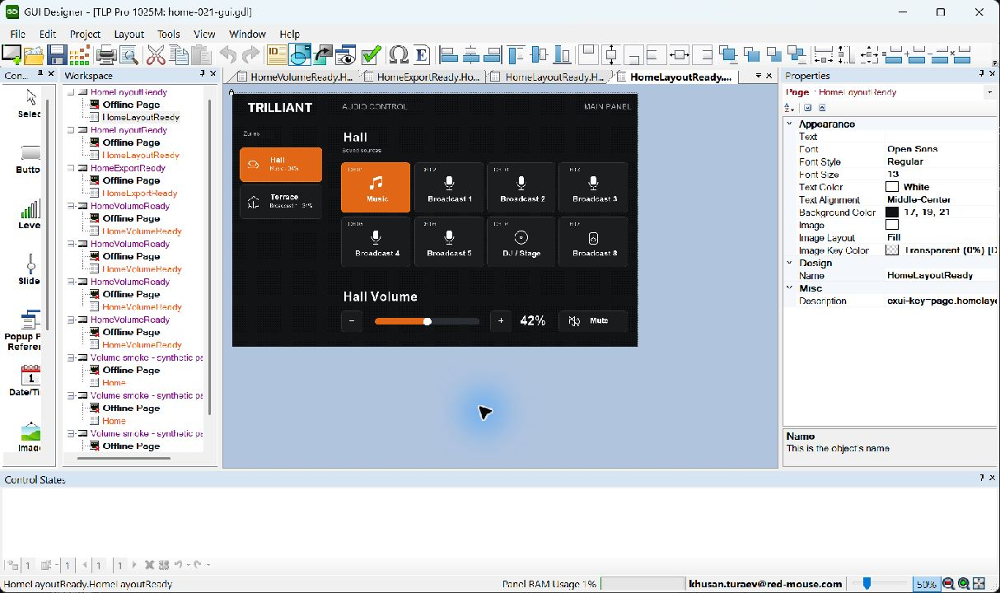

# Figma → Extron Exporter

**0.5.1: оформление кнопок:** выбрать экран → проверить два образца → явно выбрать пропуск или обновление готовых кнопок → **«Применить оформление»** → **«Проверить и скачать .exui»**. Недостающие состояния создаются, фон готовых обновляется только по выбору; иконки, подписи, ручной Pressed и ID сохраняются. [Инструкция](src/figma-plugin/BUTTON_STATES.md). Архивы прежних релизов ниже не изменяются.

**Текущий комплект: плагин 0.5.1 + CLI 0.5.1.** Только EXUI/5. Кнопки из Group/Frame, единое применение оформления по образцам с явным выбором пропуска или обновления готовых кнопок. [Плагин](output/releases/0.5.1/figma-extron-plugin-0.5.1.zip) · [CLI Windows](output/releases/0.5.1/figma-extron-cli-0.5.1-windows.zip) · [инструкция состояний](src/figma-plugin/BUTTON_STATES.md). Старые EXUI/1–4 нужно экспортировать заново из Figma; ключи и ID сохраняются.

**Для новых макетов:** Off / On — включение или выбор; Normal / Pressed — нажатие и удержание; Normal / Active / Pressed — выбор с отдельным видом нажатия. Две первые схемы — `button_` / `btn_`, третья — `feedbackbutton_` / `fbtn_`. Passive / Active и готовые кнопки без Pressed остаются совместимыми; имена и ID не переписываются. Создание по эталонам по-прежнему добавляет Off / On либо Normal / Active, Pressed оформляется вручную.

**Плагин 0.3.6 preview:** ошибки распознавания показывают путь до слоя, фактический тип, инструкцию исправления и кнопку «Показать слой». После исправления можно повторно проверить исходный макет из отчёта. [Обновление и установка](releases/figma-plugin/0.3.6/README.md).

**Плагин 0.3.5 preview:** ключи и свободные ID назначаются автоматически при проверке и скачивании `.exui`. Копии и совпадающие назначения отдельно подготовленных экранов исправляются в одном проекте; повторный экспорт сохраняет выданные значения. Диапазон регуляторов по умолчанию — 0–100, свои настройки сохраняются. [Обновление и установка](releases/figma-plugin/0.3.5/README.md).

**Плагин 0.3.4 preview:** прямые горизонтальные и вертикальные линии Pen Tool и Line Tool экспортируются в редактируемый PBLine без PNG. Имена `line_Divider` / `ln_Divider`, цвет и толщина — через Stroke CENTER. [Обновление и инструкция](releases/figma-plugin/0.3.4/README.md).

**Плагин 0.3.3 preview:** выбранные фреймы и экраны открытой страницы экспортируются в один проект без секции. Выделить Main и Audio Control → распознать → сохранить назначения → экспортировать. [Обновление и инструкция](releases/figma-plugin/0.3.3/README.md).

**Плагин 0.3.2 preview:** секции Figma поддерживаются как проекты, убрано демо из UI, настройки свёрнуты, проверка и экспорт закреплены внизу. Переходы выбираются по имени страницы. [Обновлённый плагин](releases/figma-plugin/0.3.2/README.md).

**Extron Kit:** библиотека из 30 компонентов, созданная в pen.dev, теперь генерируется в Figma локальным плагином без MCP и платной подписки. [Инструкция](src/figma-plugin/EXTRON_KIT.md) · [исходный кит и превью](design/extron-kit/README.md). Свободное оформление кнопок/изображений, экземпляры компонентов и уникальные ID проверены автоматически; новый реальный Desktop/Build-цикл ещё не пройден. Стабильный комплект ниже остаётся 0.2.1.

В обновлённом preview снят отдельный предел **16 PNG** для exui/5: количество изображений ограничивается размерами пакета и JSON. Нужны обновлённые **плагин 0.3.2 и CLI 0.3.0**; старый CLI 0.2.1 по-прежнему принимает до 16 PNG. Сохраняются 4 MiB на PNG, 16 MiB распакованный пакет, manifest.json 64 KiB и screen.json 256 KiB. Старые форматы exui/1–4 не изменены.

Текущие состояния кнопок, имена с точками и большие пакеты проверены на native-конвертации обеих панелей: [протокол и локальный комплект 0.3.0](verification/results/2026-10-21-flexible-authoring.md). GUI Designer Build и оборудование для этой ревизии ещё не проверены.

Актуальный плагин — [0.5.1 preview](releases/figma-plugin/0.5.1/README.md), CLI — 0.5.1. Секции и существующие Frame-проекты поддерживаются; plugin ID и старые сборки сохранены.

[](releases/figma-plugin/0.5.1/README.md)
[](src/figma-plugin/README.md)
[](releases/cli/0.5.1/README.md)
[](Directory.Build.props)

Плагин Figma и локальный CLI для переноса подготовленных интерфейсов в редактируемые проекты Extron GUI Designer. Дизайнер задаёт структуру экранов, состояния и ID; плагин сохраняет пакет `.exui` с описанием и PNG, а CLI создаёт новый `.gdl` с нативными элементами Extron.

Поддержаны **TLP Pro 1025M — 1280×800** и **TLP Pro 300M — портрет 320×480**. Макет нужно подготовить по стандарту проекта; произвольный дизайн Figma автоматически не преобразуется. Build выполняется в GUI Designer, команды и обратную связь задаёт программа управления Extron.

**Плагин 0.5.1 + CLI 0.5.1:** [скачать плагин](output/releases/0.5.1/figma-extron-plugin-0.5.1.zip) · [скачать CLI для Windows](output/releases/0.5.1/figma-extron-cli-0.5.1-windows.zip) · [инструкция CLI](releases/cli/0.5.1/README.md).

[Быстрый старт](#быстрый-старт) · [Рабочий процесс](#рабочий-процесс-figma--extron) · [Все префиксы](#все-префиксы-слоёв-figma) · [Запуск из исходников](#разработка-из-исходников) · [Структура проекта](#структура-проекта)

В текущем **0.4.0 preview** `button_` / `btn_` принимает два состояния: **Off / On**, **Passive / Active** либо **Normal / Pressed**. Для `feedbackbutton_` / `fbtn_` достаточно **Normal / Active**; **Pressed необязателен**. Экспортируются только существующие состояния и PNG. Старые назначения и ID сохраняются. Архив 0.2.2 ещё требует строгие Off / On либо Normal / Active / Pressed; [его протокол](verification/results/2026-10-21-button-types.md). Прежний GUI-прогон ниже относится к Home 0.2.1.



Home 1025M из установленного плагина 0.2.1 прошёл Verify **0 ошибок / 0 предупреждений**, Save and Build и повторное открытие. [Протокол выпуска](verification/results/2026-10-21-release-0.2.1.md). Работа на физической панели ещё не проверена.

## Быстрый старт

Для первого результата использовать текущие архивы **плагина 0.5.1 и CLI 0.5.1** по ссылкам в начале README. Проверить пример `.exui` можно сразу после установки Runtime; для получения `.gdl` понадобятся Extron и доноры. Для сборки текущего preview перейти к [запуску из исходников](#разработка-из-исходников), для работы с библиотекой компонентов — к [инструкции Extron Kit](src/figma-plugin/EXTRON_KIT.md).

### 1. Установить комплект и экспортировать пример

Для запуска готового CLI нужен **Windows и .NET 10 Runtime x64**. Для конвертации дополнительно нужны **GUI Designer 1.28.0.7**, 32-битный Windows PowerShell 5.1 и закреплённые доноры — локальные проекты-образцы, из которых адаптер создаёт объекты. Исходники, Node.js и .NET SDK для готового CLI не нужны.

1. Распаковать архивы плагина и CLI в постоянные папки. Обычный архив CLI содержит пример `.exui` и реестр, но **не содержит донорские GDL**. Для конвертации подготовить их по разделу [«Доноры и установка Extron»](#доноры-и-установка-extron).
2. В Figma Desktop выбрать **Plugins → Development → Import plugin from manifest…** и указать `manifest.json` из распакованного плагина. Сохранить его ID: к нему привязаны назначения элементов. После запуска заголовок должен показывать **0.5.1**.
3. Выбрать профиль панели, раскрыть **«Библиотека компонентов» → «Создать Extron Kit»**, оставить пример экрана выбранным, затем **«Проверить макет» → «Скачать .exui»**. Для демо в Figma должны быть доступны Arial Regular и Bold. [Подробная инструкция плагина](src/figma-plugin/README.md).

### 2. Проверить пакет и получить карту ID

Первую проверку CLI можно выполнить без Figma, Extron и доноров на примере из архива. В PowerShell **из папки распакованного CLI**:

```powershell
.\ExtronExporter.ps1 validate-package .\examples\home-1025m\home.exui
.\ExtronExporter.ps1 id-map .\examples\home-1025m\home.exui
```

Ожидаемый результат: `validate-package` выводит JSON с `contract: "exui/5"`, профилем TLP Pro 1025M, 47 элементами и 15 ресурсами; `id-map` печатает Markdown-карту ID для программиста.

### 3. Получить GDL и открыть его в GUI Designer

После [подготовки Extron и доноров](#доноры-и-установка-extron) из той же папки CLI:

```powershell
New-Item -ItemType Directory -Force .\converted | Out-Null
.\ExtronExporter.ps1 convert-package .\examples\home-1025m\home.exui .\converted\home.gdl
```

Для своего экспорта заменить путь `home.exui` на путь скачанного файла. Результат — новый `home.gdl` и `home.gdl.report.json` с независимыми проверками. Открыть копию GDL в GUI Designer, проверить вид, редактирование и ID, выполнить **Verify → Save and Build → закрыть и открыть снова**.

Каждой конвертации нужно новое имя результата: существующие GDL и отчёт не перезаписываются. Повторный экспорт не переносит ручные правки из прежнего GDL. Отдельного Desktop UI для конвертера пока нет.

## Рабочий процесс Figma → Extron

```text
Подготовленный Frame или проект в Figma
  → назначения элементов, состояний и постоянных ID
  → проверка и экспорт .exui (JSON + PNG)
  → CLI: validate-package → id-map → convert-package
  → новый .gdl + .gdl.report.json
  → GUI Designer: редактирование → Verify → Save and Build → повторное открытие
  → программа управления Extron и проверка на панели
```

| Этап | Действие и результат |
|---|---|
| Дизайн | Подготовить макет по [стандарту](src/figma-plugin/AUTHORING_STANDARD.md) или собрать экран из [Extron Kit](src/figma-plugin/EXTRON_KIT.md) в preview 0.3.2 |
| Назначения | Распознать имена, проверить отчёт, сохранить назначения; при дальнейших правках сохранять ключи и ID |
| Экспорт | Проверить выбранный экран/проект и скачать `.exui`; включённые скрытые состояния экспортируются вместе с видимыми |
| Конвертация | Проверить пакет, получить карту ID, создать новый `.gdl` и изучить отчёт независимой проверки |
| GUI Designer | На копии результата проверить внешний вид, состояния, редактируемость и ID; выполнить Verify, Build и повторное открытие |
| Интеграция | По карте ID назначить команды, переходы, feedback и связь Slider/Value в программе управления; проверить поведение на панели |

После изменения дизайна повторить экспорт и конвертацию **в новое имя GDL**, затем снова пройти GUI-проверку. Изменения, сделанные только в прежнем GDL, в этот цикл автоматически не возвращаются.

## Подготовить собственный макет

1. Создать Frame нужного размера. Для одного экрана использовать `Home`, `scr_Home` или `screen_Home`; для нескольких страниц и popup — структуру `project_` по стандарту.
2. Назвать элементы поддержанными префиксами, например `button_Music`, `feedbackbutton_Mute`, `slider_Volume`, `value_VolumeValue`, `logo_Company`. В текущем preview для button_/btn_ подготовить два состояния: Off / On, Passive / Active или Normal / Pressed; для feedbackbutton_/fbtn_ — Normal / Active с необязательным Pressed. Прежние сохранённые назначения продолжают работать без миграции.
3. Выбрать внешний Frame и профиль → **«Скачать .exui»** или **«Проверить макет»**. В 0.3.5 ключи и свободные ID заполняются автоматически, включая копии и конфликты. Существующие уникальные назначения и свойства сохраняются. **«Распознать по именам»** остаётся необязательным предварительным просмотром назначений.
4. Выполнить **«Проверить экран» → «Скачать .exui»**, затем валидацию и конвертацию CLI.

[Справочник префиксов с примерами](src/figma-plugin/PREFIXES.md) · [Таблица назначения элементов](docs/figma-prefix-reference.md) · [Шпаргалка в PDF](docs/prefix_map/figma-extron-prefix-cheatsheet.pdf) · [Полный стандарт подготовки макета v2.3](src/figma-plugin/AUTHORING_STANDARD.md).

## Все префиксы слоёв Figma

Короткие и полные варианты равнозначны, регистр не важен: `btn_Music` и `BUTTON_MUSIC` обозначают один тип. После префикса — имя латиницей, начинающееся с буквы; допустимы цифры, точки и дефисы между непустыми частями, пробелы и дополнительные `_` запрещены. В текущем preview можно оставить `button_side.hall`: имя сохраняется, новый ключ — `home.side.hall`. Другие примеры: `slider_HallVolume`, `value_HallVolumeValue`, `button_HallMute`. Видимый текст может быть русским.

### Проект, страницы и popup

| Назначение | Короткий префикс | Полный префикс | Пример и структура |
|---|---|---|---|
| Проект | `prj_` | `project_` | `project_Trilliant` — внешний Frame со страницами, popup и группами |
| Страница / отдельный экран | `scr_` | `screen_` | `screen_Home`; можно просто `Home`. Frame точного размера панели |
| Обычный popup | `pop_` | `popup_` | `popup_Sources` — Frame внутри проекта или группы popup |
| Модальный popup | `mdl_` | `modalpopup_` | `modalpopup_Confirm` — Frame внутри проекта, размером с панель |
| Группа popup | `pgrp_` | `popupgroup_` | `popupgroup_Zones` — Frame с обычными popup одинакового размера |
| Место popup на странице | `pr_` | `popupref_` | `popupref_Sources` — пустой Frame размера popup; автоцель `popup.sources`, группу задают через форму |

### Элементы страницы или popup

| Назначение | Короткий префикс | Полный префикс | Пример и результат в Extron |
|---|---|---|---|
| Обычная кнопка | `btn_` | `button_` | `button_Music` — PBButton, 2 состояния: **Off / On**, **Passive / Active** либо **Normal / Pressed** в preview |
| Кнопка с обратной связью | `fbtn_` | `feedbackbutton_` | `feedbackbutton_Mute` — PBButton, **Normal / Active**, необязательный **Pressed** в preview |
| Простой регулятор уровня | `lvl_` | `level_` | `level_Volume` — PBLevel в режиме Slider; пустой Frame со сплошной заливкой |
| Кастомный ползунок | `sld_` | `slider_` | `slider_Volume` — PBSlider; Frame с частями Track, Fill, Thumb |
| Индикатор уровня | `gau_` | `gauge_` | `gauge_Signal` — PBLevel в режиме Gauge |
| Индикатор значения | `ind_` | `indicator_` | `indicator_Status` — тот же PBLevel Gauge, не отдельная лампа |
| Светодиодная шкала | `led_` | `volumeled_` | `volumeled_Audio` — PBLevel в режиме VolumeLED |
| Уровень с несколькими состояниями | `mlvl_` | `multilevel_` | `multilevel_Status` — PBLevel MultistateLevel, 2–8 состояний, без Pressed |
| Статичная подпись | `txt_` | `text_` | `text_Title` — Text → PBLabel без управляющего ID |
| Обновляемая подпись | `val_` | `value_` | `value_VolumeValue` — Text → PBLabel с dynamicText и собственным controlId |
| Логотип | `logo_` | `logo_` | `logo_Company` — Frame → PNG и самостоятельный PBImage; сокращения нет |
| Статичная картинка | `img_` | `image_` | `image_Cover` — Frame → PNG и самостоятельный PBImage |
| Фигура | `shp_` | `shape_` | `shape_Card` — Frame/Rectangle/Ellipse → PBShape |
| Линия | `ln_` | `line_` | `line_Divider` — Frame/Rectangle → PBLine; меньшая сторона задаёт толщину |
| Дата и время | `dt_` | `datetime_` | `datetime_Clock` — Text с форматом, например `HH:mm`, → PBDateTime |

Элементы размещаются непосредственно в странице или popup. Понятные разные имена упрощают карту ID: рядом со `slider_Volume` удобно использовать `value_VolumeValue`. В 0.3.5 одинаковые имена обычных слоёв и экземпляров разрешены: повторяющиеся ключи получают суффиксы `-2`, `-3` и свободные ID. Сохранённые уникальные назначения имеют приоритет над переименованием.

### Состояния и внутренние части

| Назначение | Префиксы / имена | Пример и расположение |
|---|---|---|
| Состояние | `st_`, `state_` | Frame внутри Button или Multistate Level: `state_Normal`, `st_On`, `state_Ready` |
| Исходный вид | `Normal`, `Off`, `Passive` | Также с `st_` / `state_`; роль normal, Passive добавлен в текущем preview |
| Обратная связь | `On`, `Active`, `Feedback` | Также с `st_` / `state_`: `st_On`, `state_Active`, `state_Feedback`; роль feedback |
| Нажатие | `Pressed` | Также `st_Pressed`, `state_Pressed`; роль pressed, пока кнопку удерживают |
| Дополнительный feedback | `st_Name`, `state_Name` | Например `state_Ready`, `state_Error`, `state_Disabled`; Multistate Level и прежние назначения кнопок |
| Иконка состояния | `ico_`, `icon_`, отдельное имя `Icon` | `icon_Music` — Frame внутри состояния → PNG-ресурс; не отдельный элемент экрана |
| Части Slider | `Track`, `Fill`, `Thumb` | Имена без префикса, три дочерних слоя внутри `slider_Volume` |

В текущем preview **новые** `button_` / `btn_` имеют ровно два состояния: normal и feedback либо pressed. Для `feedbackbutton_` / `fbtn_` нужны normal и feedback; pressed необязателен. Normal / Off / Passive — синонимы, On / Active / Feedback — синонимы; префиксы `st_` / `state_` допустимы. Существующие имена и оформление сохраняются, отсутствующие состояния не создаются. Прежние сохранённые назначения поддерживают свои схемы состояний. Общий предел — 8 состояний; Disabled задаёт внешний вид, блокировку выполняет программа управления. Архив 0.2.2 имеет прежние строгие наборы.

В Extron Kit preview 0.3.2 есть служебные слоты `Artwork / Off`, `Artwork / On`, `Artwork / Normal`, `Artwork / Active`, `Artwork / Pressed`. Это внутренние имена кита, их следует сохранять. [Правила редактирования экземпляров](src/figma-plugin/EXTRON_KIT.md).

### Зарезервированные префиксы

| Назначение | Короткий префикс | Полный префикс | Статус |
|---|---|---|---|
| Видео | `vid_` | `video_` | `video_Preview` — явная ошибка для 1025M/300M; экспорт не поддержан |
| Динамическая картинка | `dimg_` | `dynamicimage_` | `dynamicimage_Cover` — явная ошибка для 1025M/300M; для статичной картинки использовать `image_` |

Префикс определяет тип объекта. Имена `button_VolumeUp`, `button_VolumeDown`, `button_Mute` или `value_VolumeValue` сами по себе не назначают AV-команды и не создают связь между элементами. Размеры, оформление и вложенность проверяются дополнительно по [стандарту подготовки](src/figma-plugin/AUTHORING_STANDARD.md).

В 0.2.1 кнопка может иметь ровно пустую собственную подпись в `.exui/5`, а видимый текст — отдельные нативные Label/Value поверх неё. Для этого нужны **плагин и CLI 0.2.1**. Цвет таких подписей не следует за состоянием кнопки автоматически; касания под ними и удержания ещё требуют проверки на панели.

Нативный редактируемый текст поддерживает Arial Regular/Bold и 18 начертаний Inter / Inter Display, со встроенным в GDL шрифтом. Поддержаны все девять выравниваний. Другие шрифты и сложное оформление статических txt_/text_ автоматически становятся PNG без ручного Frame; дробная геометрия графики сохраняется внутри прозрачных целых границ. Value/DateTime остаются нативными и обновляемыми. Произвольные effects, gradients, opacity и prototype interactions на нативных элементах не переносятся. Сложная графика допустима внутри растеризуемых изображений. Видео и Dynamic Image для этих профилей не поддержаны. Полные правила и диагностика — в стандарте.

Переходы, selectionGroup, доступность/видимость и другие указания попадают в `id-map` для программы управления. CLI не создаёт AV-логику: связь Slider/Value, команды «+»/«−», начальное значение и Mute feedback задаются программой Extron.

## Доноры и установка Extron

В [samples/donors.json](samples/donors.json) закреплены профили, элементы и SHA-256 доноров. Для обычного CLI скопировать проверенные `tlp-pro-1025m.gdl` и `tlp-pro-300m-portrait.gdl` из основной рабочей папки в `samples/donors/` распакованного комплекта. Произвольный GDL не заменяет донора.

Если доноров нет, нужен исходный `Full-Test-Project.gdl`, совпадающий с [манифестом образцов](samples/manifest.json). Поместить его в `samples/original/` комплекта и из папки CLI выполнить:

```powershell
.\ExtronExporter.ps1 prepare-donor tlp-pro-1025m
.\ExtronExporter.ps1 prepare-donor tlp-pro-300m-portrait
```

Крупные сторонние образцы и доноры исключены из Git; одного клонирования репозитория для конвертации недостаточно. Полный локальный комплект с обоими донорами хранится отдельно в игнорируемом `output/`. [Состав и инструкция](releases/cli/0.2.1/README.md).

По умолчанию адаптер использует `C:\Program Files (x86)\Extron\GUI Designer`. Другой путь задаётся `--extron-dir` или `EXTRON_GUI_DESIGNER_DIR`, другой реестр — `--registry`. Лаунчер `ExtronExporter.ps1` выбирает реестр рядом с собой; пути входа и результата остаются относительно текущей папки. Для отдельной установки .NET доступна переменная `EXUI_DOTNET_EXE`.

DLL Extron не входят в поставку и загружаются только из установленного GUI Designer в отдельном x86-процессе `C:\Windows\SysWOW64\WindowsPowerShell\v1.0\powershell.exe`. Основной процесс .NET читает NRBF через Microsoft `System.Formats.Nrbf` 10.0.11 без создания объектов Extron. [Решения по адаптеру и доверенным донорам](docs/decisions.md).

## Разработка из исходников

Для .NET-части нужен SDK **10.0.402** с политикой `latestPatch` из [global.json](global.json); для плагина — **Node.js ≥22.18** и npm. Зависимости закреплены lock-файлами. Команды ниже выполняются в PowerShell **из корня репозитория**.

### Первый запуск CLI без Extron

```powershell
$dotnet = 'dotnet'
# Если SDK подготовлен локально, вместо этого: $dotnet = '.\.tools\dotnet\dotnet.exe'
& $dotnet restore ExtronExporter.slnx --locked-mode
& $dotnet build ExtronExporter.slnx --no-restore
& $dotnet run --project src/cli --no-build -- validate-package examples/exui-v5/expanded-1025m.exui
& $dotnet run --project src/cli --no-build -- id-map examples/exui-v5/expanded-1025m.exui
```

Ожидаемый результат: пакет `exui/5`, профиль TLP Pro 1025M, 9 элементов без PNG и карта их ID. Это проверка сборки и чтения примера; Extron и доноры не нужны.

### Конвертация примера из исходников

Нужны GUI Designer и [закреплённые доноры](#доноры-и-установка-extron) в `samples/donors/` репозитория. Если есть только эталонный `samples/original/Full-Test-Project.gdl`, сначала подготовить донора; если он уже подготовлен, первую команду пропустить:

```powershell
& $dotnet run --project src/cli --no-build -- prepare-donor tlp-pro-1025m
New-Item -ItemType Directory -Force output/quick-start | Out-Null
& $dotnet run --project src/cli --no-build -- convert-package examples/exui-v5/expanded-1025m.exui output/quick-start/expanded-1025m.gdl
```

Результат — `output/quick-start/expanded-1025m.gdl` и соседний `.gdl.report.json`. Для повторного запуска указать новое имя. Далее выполнить GUI-цикл из [рабочего процесса](#рабочий-процесс-figma--extron). CLI из исходников выбирает `samples/donors.json` относительно текущей папки; другой реестр передаётся через `--registry`.

### Собрать и запустить плагин

```powershell
npm ci --prefix src/figma-plugin --ignore-scripts
npm run verify --prefix src/figma-plugin
npm run package --prefix src/figma-plugin
```

`verify` выполняет typecheck, тесты и сборку. Готовый архив создаётся в `output/figma-plugin/`; существующий архив не заменяется. В Figma Desktop импортировать `src/figma-plugin/manifest.json` после сборки. Текущие исходники — preview 0.3.2: для первого экрана создать демо либо воспользоваться [Extron Kit](src/figma-plugin/EXTRON_KIT.md), затем экспортировать `.exui` и передать его CLI по описанному выше процессу. [Browser QA, интеграция с CLI и разработка плагина](src/figma-plugin/README.md#сборка-и-проверки-из-корня-репозитория).

### Проверки и упаковка

.NET-проверки — исполняемый набор, запускаемый через `dotnet run`:

```powershell
& $dotnet run --project tests/format --no-build
# При наличии закреплённых доноров и установленного GUI Designer:
& $dotnet run --project tests/format --no-build -- --registry samples/donors.json --integration
```

Первый прогон не требует Extron и локальных образцов. Интеграционный прогон генерирует проекты обеих панелей через адаптер; открытие, Verify и Build в GUI Designer выполняются отдельно. Проверки готовых архивов и команды их повторения — в [протоколе выпуска](verification/results/2026-10-21-release-0.2.1.md).

Для упаковки плагина и Release CLI после восстановления зависимостей:

```powershell
.\scripts\Package-Release.ps1 -DotnetExe $dotnet
```

Скрипт пишет в `output/releases/<версия плагина>/` и отказывается заменять существующие архивы; версия плагина и совместимая версия CLI определяются в `src/figma-plugin/package.json`. Для повторной упаковки задать новый `-OutputDirectory`. Состав обычного и полного локального комплектов описан в [инструкции выпуска](releases/cli/0.2.1/README.md#воспроизводимая-упаковка-из-репозитория).

## Дополнительные команды CLI

Команды передаются лаунчеру готового комплекта или запускаются из исходников через `& $dotnet run --project src/cli --no-build --`.

| Команда и аргументы | Назначение |
|---|---|
| `validate-package <input.exui>` | Проверка ZIP, схем, ID, ссылок и ресурсов без Extron |
| `id-map <input.exui>` | Markdown-карта страниц, popup, ID, состояний и указаний программе |
| `convert-package <input.exui> <new-output.gdl>` | Новый редактируемый GDL и независимый отчёт; требует Extron и донора |
| `inspect <input.gdl\|glt>` | JSON-инвентаризация контейнера и NRBF, включая файл после Save and Build |
| `list-controls <input.gdl>` | Профиль, страницы, popup, элементы, ID, состояния, ресурсы и данные Build |
| `compare-graph <a.gdl> <b.gdl>` | Сравнение графов без учёта ID записей; отдельно — без служебного `_version` |
| `repack <input> <new-output>` | Пересборка контейнера с побайтовым сохранением payload и дополнительных записей |
| `set-button-text <input> <new-output> <button-id> <expected-text> <new-text>` | Ограниченная замена текста состояний существующей кнопки с сохранением ID |
| `prepare-donor <donor-id>` | Подготовка закреплённого донора из эталона |
| `generate-screen <screen.json> <donor-id> <new-output.gdl>` | Экспериментальный путь из JSON одной страницы; [пример и воспроизведение](examples/first-screen/README.md) |

`prepare-donor`, `generate-screen` и `convert-package` принимают `--registry` и `--extron-dir`. Каталог назначения должен существовать, выходной файл — быть новым. Коды выхода: **0** — успех, **1** — отказ при обработке, **2** — неверные аргументы. При отказе адаптера сообщение содержит код, например `donor-missing`, `donor-hash`, `extron-version` или `output-exists`.

Редактор подписи поддерживает наблюдаемый профиль 1.28.0.7 с нулевым checksum; formatted text и общие с другими объектами строки/состояния отклоняются. Ограничения контейнера и результаты проверок — в [описании формата](docs/extron-format.md) и [протоколе редактирования](verification/results/2026-10-19-gui-text-edit.md).

## Что подтверждено

- **Комплект 0.2.1, Home 1025M:** настоящий экспорт установленного плагина → CLI из распакованного комплекта, 47 элементов / 15 PNG, 432/432 независимых проверок; GUI Verify 0/0 → Save and Build → повторное открытие, 426/426 после Build. [Протокол и артефакты](verification/results/2026-10-21-release-0.2.1.md).
- **Профиль 300M:** реальный экспорт демо из Figma преобразован в GDL, 65/65; отдельный GUI-цикл именно этого экспорта остаётся незавершённым. [Протокол Figma](verification/results/2026-10-19-figma-real-export.md). Более ранние экраны обеих панелей прошли [собственный GUI-цикл](verification/results/2026-10-19-first-screen.md).
- **Расширенные типы, страницы и popup:** есть автоматические сценарии обеих панелей; GUI-цикл Home 1025M не подтверждает все остальные сочетания. [Проверки расширенных элементов](verification/results/2026-10-20-expanded-controls.md).

Оборудование, касания под отдельными подписями, удержания и feedback ещё не проверены. Облачная сохранность private metadata после перезапуска Figma Desktop также остаётся отдельной проверкой. Результат независимого чтения GDL подтверждает данные; каждому новому проекту нужен свой GUI-цикл.

## Структура проекта

```text
figma-extron-exporter/
├── src/
│   ├── figma-plugin/            TypeScript-плагин и инструкции для дизайнера
│   │   ├── manifest.json       Точка импорта плагина в Figma Desktop
│   │   ├── src/                Назначения, распознавание, Extron Kit и экспорт
│   │   └── test/               Тесты плагина, Chromium UI и интеграция с CLI
│   ├── cli/Program.cs          Команды и аргументы консольного приложения
│   ├── screen/                 Контракт EXUI/5, валидация, карта ID и verifier
│   ├── extron/                 Контейнер, NRBF, модель GDL и редактор подписи
│   └── adapter/                Реестр доноров, генерация и граница процесса Extron
│       └── host/               x86 PowerShell-хост записи через установленный Extron
├── design/extron-kit/          Каталог компонентов, снимок pen.dev и превью
├── schemas/                    JSON Schema версий пакета .exui
├── examples/                   Пакеты .exui, JSON, ресурсы и воспроизведение примеров
├── samples/
│   ├── donors.json             Реестр доноров, профилей и закреплённых SHA-256
│   ├── manifest.json           Манифест исходных образцов
│   ├── original/               Локальные сторонние исходники; исключены из Git
│   └── donors/                 Подготовленные донорские GDL; исключены из Git
├── tests/format/               Исполняемый набор .NET-проверок
├── verification/               Ручной чек-лист, протоколы и артефакты проверок
├── scripts/                    Лаунчер CLI и упаковка релизного комплекта
├── releases/                   Готовые архивы плагина и CLI с инструкциями
├── docs/                       Контракты, исследование формата и технические решения
├── output/                     Локальные GDL, отчёты и сборки; исключены из Git
├── ExtronExporter.slnx         Решение .NET
├── Directory.Build.props       Общие настройки .NET-проектов
└── global.json                Закреплённая версия .NET SDK
```

Основной поток кода: `src/figma-plugin` создаёт пакет → `src/cli` вызывает проверку в `src/screen` и генерацию через `src/adapter` → результат читается независимо через `src/extron`. DLL Extron загружаются только в дочернем хосте адаптера. Папки `output/`, `samples/original/` и `samples/donors/` заполняются локально; после клонирования их содержимого может не быть.

## Документация

- [Контракт `.exui/5`](docs/exui-v5.md) и [примеры расширенных элементов и проектов](examples/exui-v5/README.md).
- Прежние контракты: [v1 — один экран](docs/exui-v1.md), [v2 — страницы и popup](docs/exui-v2.md), [v3 — без Pressed](docs/exui-v3.md), [v4 — изображения и Normal/Pressed](docs/exui-v4.md). CLI читает версии 1–5; плагин выбирает 1, 3, 4 или 5 по содержимому.
- [Результаты проверок и ручной чек-лист](verification/checklist.md), [исследованный формат Extron](docs/extron-format.md), [технические решения](docs/decisions.md).
- [Текущий статус работ](ROADMAP.md), [план разработки](DEVELOPMENT_PLAN.md), [исследование аналогов](docs/analogue-research-2026-10-19.md).

Оформление и части экспорта плагина адаптированы из **Baolv/figma-export** по разрешению пользователя. Происхождение и сведения о лицензиях зависимостей — в [THIRD_PARTY_NOTICES.md](src/figma-plugin/THIRD_PARTY_NOTICES.md); использование приёмов extron-gdl-toolkit описано в [технических решениях](docs/decisions.md#d010--использование-extron-gdl-toolkit). Тексты разрешений upstream в репозиторий не переданы; эти записи не заменяют их условия.
