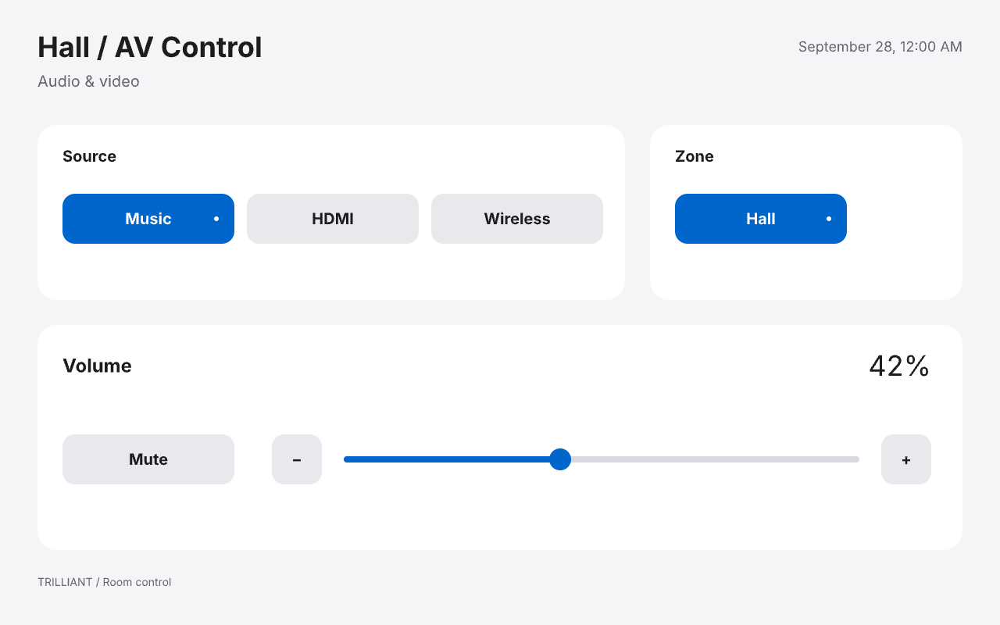
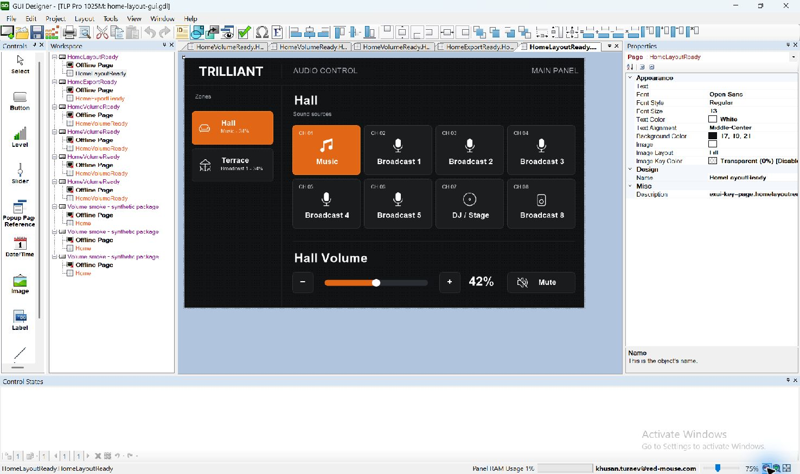
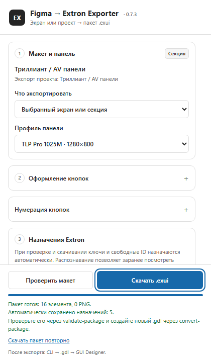
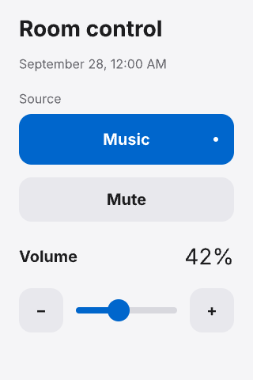

<h1 align="center">Figma → Extron Exporter</h1>

<p align="center">
  <strong>От макета сенсорной панели — к редактируемому проекту Extron.</strong><br>
  Кнопки, слайдеры и поддержанные подписи остаются редактируемыми в GUI Designer.
</p>

<p align="center">
  <a href="#статус-проекта"></a>
  <a href="#совместимость"></a>
  <a href="#совместимость"></a>
</p>

<p align="center">
  <a href="https://github.com/Elguajo/figma-extron-exporter/releases"><strong>Скачать preview</strong></a> ·
  <a href="#быстрый-старт">Быстрый старт</a> ·
  <a href="#документация">Документация</a> ·
  <a href="docs/development.md">Разработка</a>
</p>



<p align="center"><sub>Макет из локального Extron Kit · TLP Pro 1025M · Apple-inspired Light, 24.10.2026.<br>В скачиваемом комплекте — предыдущая версия оформления.</sub></p>

---

## Как это работает

Подготовьте экран в Figma, выгрузите пакет `.exui` и преобразуйте его локальным CLI в `.gdl`. Результат открывается в **Extron GUI Designer**: контролы, состояния и поддержанный текст можно редактировать дальше.

```text
Figma  →  плагин  →  .exui  →  CLI  →  .gdl  →  GUI Designer
                                               Verify → Save and Build
```

| В Figma | В проекте Extron |
|---|---|
| Экран и всплывающие окна (popup) | Страницы, popup и связи между ними |
| Кнопки и их состояния | Нативные контролы с отдельным оформлением состояний |
| Слайдеры, значения и подписи | Редактируемые элементы; текст — в пределах [контракта шрифтов](src/figma-plugin/NATIVE_TEXT.md) |
| Иконки и сложная графика | Ресурсы PNG |
| Сохранённые назначения | Идентификаторы элементов (ID) и карта для программиста; ID сохраняются при редактировании существующих слоёв |

Макет готовится по правилам имён и структуры. Например, `button_Mute` становится кнопкой, а команду отключения звука и её обратную связь от оборудования (feedback) подключает программист Extron. Взаимодействия из Figma Prototype автоматически не переносятся.

<details>
<summary><strong>Посмотреть результат реального экспорта в GUI Designer</strong></summary>



Проверка **21.10.2026**, TLP Pro 1025M: 47 элементов, 15 PNG, **Verify: 0 ошибок / 0 предупреждений**, Save and Build и повторное открытие. Это отдельный рабочий макет; [протокол и границы проверки](verification/results/2026-10-21-home-layout-1025m.md).

</details>

## Совместимость

| Что понадобится | Для чего |
|---|---|
| **Figma Desktop** и права редактирования Design-файла | Подготовить и выгрузить свой макет |
| **TLP Pro 1025M** — 1280 × 800 или **TLP Pro 300M** — портрет 320 × 480 | Выбрать размер экрана и профиль экспорта |
| **Windows**, [.NET 10 Runtime x64](https://dotnet.microsoft.com/download/dotnet/10.0), **GUI Designer 1.28.0.7** | Преобразовать выгрузку в GDL и открыть результат |

Плагин создаёт `.exui` — пакет с описанием элементов и графикой. Отдельный конвертер **CLI** превращает этот пакет в проект `.gdl` для GUI Designer. Подготовку конвертера выполняют один раз по [инструкции настройки CLI](docs/cli-setup.md).

## Быстрый старт

**Ваш экран в Figma → проверка → скачивание EXUI → конвертация → открытие GDL.**

### 1. Установите и запустите плагин

1. Откройте [GitHub Releases](https://github.com/Elguajo/figma-extron-exporter/releases). В разделе **Assets** выбранного выпуска скачайте два архива: `figma-extron-plugin-<версия>.zip` и указанный в этом выпуске совместимый `figma-extron-cli-<версия>-windows.zip`.
2. Распакуйте каждый архив в отдельную постоянную папку. ZIP-файлы открывать в Figma не нужно.
3. Откройте свой макет в **Figma Desktop**. Нужен Design-файл, который вы можете редактировать.
4. В меню Figma выберите **Plugins → Development → Import plugin from manifest…** и укажите `manifest.json` из распакованной папки плагина.
5. В том же меню выберите **Plugins → Development → «Figma → Extron Exporter»** — последнее название целиком относится к нашему плагину. Появится его окно с выбором профиля панели и кнопками **«Проверить макет» / «Скачать .exui»**.

На 24.10.2026 опубликован комплект **0.7.2**. Версия в заголовке окна должна совпадать с версией скачанного плагина. При обновлении сохраняйте `id` в `manifest.json`: к нему привязаны назначения элементов в вашем файле Figma.

### 2. Подготовьте один экран своего дизайна

Начните с одного экрана. В панели **Layers** выберите его внешний **Frame**, задайте размер выбранной панели и назовите `screen_Home`. Экспорт не подгоняет размер автоматически: для 1025M нужны **1280 × 800**, для 300M — **320 × 480**.

Назовите элементы внутри экрана так, чтобы плагин понимал их назначение:

| Элемент вашего дизайна | Имя слоя в Figma | Что получится |
|---|---|---|
| Кнопка Mute | `button_Mute` | Кнопка Extron с двумя состояниями |
| Обычная подпись | `text_Title` | Статичная подпись |
| Изменяемое значение громкости | `value_Volume` | Подпись со своим ID для обновления программой |
| Картинка или логотип в отдельном Frame | `image_Background` / `logo_Company` | Изображение PNG |

Размещайте эти элементы **непосредственно внутри Frame экрана**. После префикса (`button_`, `text_` и т. п.) начинайте имя с латинской буквы; дальше допустимы латиница, цифры, точки и дефисы между непустыми частями. Пробелы и дополнительные `_` не допускаются; видимый текст может быть русским.

Для редактируемых надписей используйте **Inter / Inter Display** или **Arial Regular / Bold**. Другие шрифты и сложное оформление статичного текста могут стать картинкой; для обновляемых значений действуют [правила нативного текста](src/figma-plugin/NATIVE_TEXT.md).

**Для кнопки нужны два вида.** Внутри Group или Frame `button_Mute` разместите две Group или Frame одинакового размера, на всю кнопку: `Off` — обычный вид, `On` — включённый. Внутри каждого состояния оставьте его фон, иконку и текст; расположите состояния друг над другом, одно скройте. У внешнего Frame `button_Mute` уберите заливку: оформление находится внутри состояний. Для кнопок удержания, например «+» и «−», используйте имена `Normal` / `Pressed`.

Готовую кнопку или слайдер можно взять из **«Библиотека компонентов» → «Создать Extron Kit»** в окне плагина. Перенесите экземпляр из **Assets** в свой экран и измените оформление, сохраняя структуру. Собственные слайдеры и более сложные кнопки подготовьте по [правилам компонентов](src/figma-plugin/AUTHORING_STANDARD.md) и [инструкции состояний](src/figma-plugin/BUTTON_STATES.md).

<details>
<summary>Пример структуры готовой кнопки в Layers</summary>

```text
screen_Home
├── button_Mute
│   ├── Off                     обычный вид: фон + иконка + текст
│   └── On                      включённый вид: фон + иконка + текст
├── text_Title
└── value_Volume
```

Полная таблица имён: [справочник префиксов](src/figma-plugin/PREFIXES.md). Несколько экранов, popup и переходы: [стандарт макета](src/figma-plugin/AUTHORING_STANDARD.md).

</details>

### 3. Проверьте экран и скачайте EXUI

1. В **Layers** выделите именно внешний Frame `screen_Home`, чтобы в экспорт вошёл весь экран.
2. В окне плагина установите **«Что экспортировать» → «Выбранный экран или секция»**.
3. В **«Профиль панели»** выберите свою модель: TLP Pro 1025M или TLP Pro 300M.
4. Внизу окна нажмите **«Проверить макет»**. При успехе появится сообщение о проверенном макете и числе элементов. ID назначаются автоматически; вручную заполнять их для первого экспорта не нужно.
5. Если показана ошибка, нажмите **«Показать слой»** в отчёте, исправьте указанную причину и повторите проверку.
6. Нажмите **«Скачать .exui»**. Найдите скачанный файл, обычно в папке **«Загрузки»**. Его имя зависит от профиля, например `interface-tlp-pro-1025m.exui`.

<details>
<summary><strong>Где находятся профиль панели, проверка и скачивание</strong></summary>



Верхняя часть окна задаёт область и модель панели, нижняя — проверяет и скачивает пакет. На снимке показан интерфейс 0.7.3; имя макета и число элементов у вас будут другими.

</details>

**Теперь у вас есть EXUI вашего дизайна.** Это промежуточный пакет; следующий шаг создаст файл, который открывается в GUI Designer.

### 4. Преобразуйте свой EXUI в GDL

Для первого запуска выполните [разовую настройку конвертера](docs/cli-setup.md), включая необходимые файлы Extron. В дальнейшем достаточно выгрузить новый EXUI и повторить команды ниже.

1. Откройте распакованную папку CLI — в ней находится `ExtronExporter.ps1`.
2. Скопируйте в эту папку скачанный `.exui`. Для команд ниже назовите эту копию **`interface.exui`**.
3. В адресной строке **Проводника** введите `powershell` и нажмите Enter. PowerShell откроется в папке CLI.
4. Сначала проверьте пакет, затем создайте новый GDL:

```powershell
.\ExtronExporter.ps1 validate-package .\interface.exui
.\ExtronExporter.ps1 convert-package .\interface.exui .\interface-v1.gdl
```

Первая команда выведет сведения о вашем макете; число элементов зависит от дизайна. После второй команды в той же папке появятся **`interface-v1.gdl`** и **`interface-v1.gdl.report.json`** — проект и отчёт его независимой проверки.

### 5. Откройте и проверьте результат

В **GUI Designer** выберите **File → Open** и откройте `interface-v1.gdl`. Проверьте профиль панели, расположение элементов, подписи и состояния кнопок. Выполните **Verify → Save and Build**, затем закройте и снова откройте проект.

Для передачи программисту создайте карту ID из того же EXUI:

```powershell
.\ExtronExporter.ps1 id-map .\interface.exui | Out-File -Encoding utf8 id-map.md
```

Передайте **GDL и `id-map.md`** — карту страниц, popup, ID и состояний. Команды оборудования и feedback программист подключает в программе управления Extron.

## Extron Kit

Готовые компоненты, состояния кнопок, шаблоны страниц и popup, примеры для обеих панелей. Оформление можно менять в Figma, сохраняя служебные имена и структуру.



**Apple-inspired Light · 24.10.2026** — оформление библиотеки в текущих исходниках. Скачиваемый комплект 0.7.2 содержит предыдущую версию оформления; показанные здесь светлые примеры доступны при [сборке из исходников](#сборка-и-проверки). Новый комплект создаётся рядом с существующим; готовые библиотеки автоматически не обновляются.

[Работа с Extron Kit](src/figma-plugin/EXTRON_KIT.md) · [Исходники и превью](design/extron-kit/README.md)

## Повторный экспорт

После первого успешного экспорта сохраните копию `interface.exui` как **`interface-v1.exui`**. Отредактируйте свой экран в Figma, снова выберите его внешний Frame, нажмите **«Проверить макет» → «Скачать .exui»**. Скопируйте новую выгрузку в папку CLI под именем **`interface-v2.exui`**.

Сравните версии и создайте новый GDL:

```powershell
.\ExtronExporter.ps1 compare-packages .\interface-v1.exui .\interface-v2.exui
.\ExtronExporter.ps1 convert-package .\interface-v2.exui .\interface-v2.gdl
```

Сравнение покажет новые и удалённые элементы, изменения ID, типов, состояний и связей. ID существующих редактируемых слоёв сохраняются; новые и скопированные элементы получают собственные ID.

**Каждая конвертация создаёт новый GDL.** Существующий файл не перезаписывается, а ручные правки прежнего GDL в новый не переносятся. Откройте новый `interface-v2.gdl` и повторите проверку в GUI Designer.

Если логика управления уже настроена в **Global Configurator (GCP)**, обновляйте копию рабочего проекта через **Layout Reconciliation** — сопоставление изменённого интерфейса с прежней конфигурацией. Для тестовой пары 1025M подтверждены сохранение действия/feedback и повторное открытие; [инструкция и границы проверки](docs/updating-configured-projects.md).

## Если что-то пошло не так

| Сообщение | Что делать |
|---|---|
| `donor-missing` / `donor-hash` | Завершить [разовую настройку конвертера](docs/cli-setup.md#необходимые-файлы-extron) |
| `extron-version` | Нужен GUI Designer 1.28.0.7; другой путь установки задаётся через `--extron-dir <папка>` |
| `output-exists` | Указать новое имя выходного GDL |
| Скачан EXUI, но GUI Designer его не открывает | Сначала [преобразовать пакет в GDL](#4-преобразуйте-свой-exui-в-gdl); в GUI Designer открыть полученный `.gdl` |
| CLI не находит `interface.exui` | Скопировать свой скачанный EXUI в папку с `ExtronExporter.ps1`, назвать копию `interface.exui` и открыть PowerShell именно в этой папке |
| Пакет EXUI/1–4 отклонён | Повторно экспортировать макет текущим плагином; сохранённые назначения и ID используются снова |
| Ошибка имени или структуры слоя | Исправить указанный слой через отчёт плагина и повторить проверку |

Коды выхода CLI: **0** — успех, **1** — ошибка обработки, **2** — неверные аргументы. [Все команды и опции](docs/development.md#команды-cli).

## Документация

| Задача | Руководство |
|---|---|
| Настроить конвертер или проверить комплектный пример | [Настройка CLI](docs/cli-setup.md) |
| Подготовить макет | [Стандарт авторинга](src/figma-plugin/AUTHORING_STANDARD.md) |
| Назвать элементы | [Справочник префиксов](src/figma-plugin/PREFIXES.md) · [PDF-шпаргалка](docs/prefix_map/figma-extron-prefix-cheatsheet.pdf) |
| Оформить кнопки и состояния | [Button States](src/figma-plugin/BUTTON_STATES.md) |
| Сохранить редактируемый текст | [Шрифты и нативный текст](src/figma-plugin/NATIVE_TEXT.md) |
| Использовать библиотеку | [Extron Kit](src/figma-plugin/EXTRON_KIT.md) |
| Обновить настроенный GCP | [Обновление проектов](docs/updating-configured-projects.md) |
| Разобраться в формате и архитектуре | [EXUI/5](docs/exui-v5.md) · [Формат GDL](docs/extron-format.md) · [Решения](docs/decisions.md) |
| Проверить результат | [Чек-лист](verification/checklist.md) · [Проверки 0.8.1](verification/results/2026-10-25-release-0.8.1.md) |
| Посмотреть изменения и планы | [CHANGELOG](CHANGELOG.md) · [ROADMAP](ROADMAP.md) |

## Сборка и проверки

Этот раздел — для работы с исходниками. При установке из готового архива Node.js и .NET SDK не нужны. Текущие исходники: **плагин 0.8.1 + CLI 0.8.1**, EXUI/5.

Для разработки нужны **.NET SDK 10.0.402** и **Node.js ≥ 22.18**. Из корня репозитория:

```powershell
dotnet build ExtronExporter.slnx
npm ci --prefix src/figma-plugin --ignore-scripts
npm run verify --prefix src/figma-plugin
```

`verify` проверяет типы, запускает тесты плагина и собирает `src/figma-plugin/dist/`. Импортируйте `src/figma-plugin/manifest.json` в Figma Desktop.

[Архитектура, тесты .NET, команды CLI и выпуск](docs/development.md)

## Статус проекта

**Preview.** Подтверждён реальный цикл Figma → EXUI → GDL → GUI Designer Verify → Save and Build → повторное открытие для [Home 1025M](verification/results/2026-10-21-home-layout-1025m.md). Для обеих панелей есть автоматические сценарии; [выпуск 0.7.3](verification/results/2026-10-23-release-0.7.3.md) проверен из итоговых архивов с реальной конвертацией и независимым чтением GDL. Новый ручной Desktop-прогон для этого выпуска не выполнялся.

Работа на физической панели, касания, удержания и аппаратный feedback пока не проверены. Каждый новый проект требует своей проверки в GUI Designer и на оборудовании.

Оформление и части экспорта плагина адаптированы из **Baolv/figma-export** по разрешению; сведения о происхождении кода и лицензиях зависимостей — в [THIRD_PARTY_NOTICES.md](src/figma-plugin/THIRD_PARTY_NOTICES.md).
