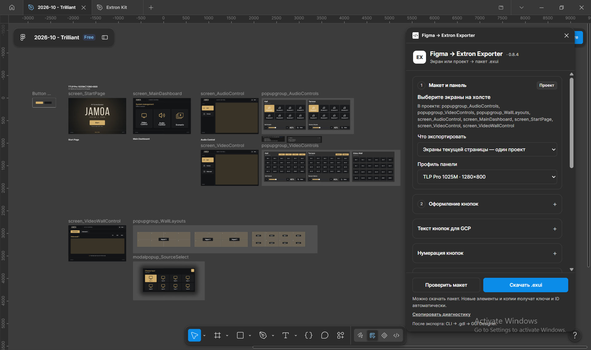
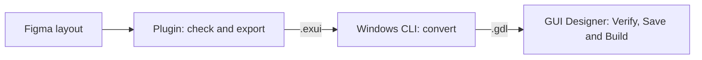
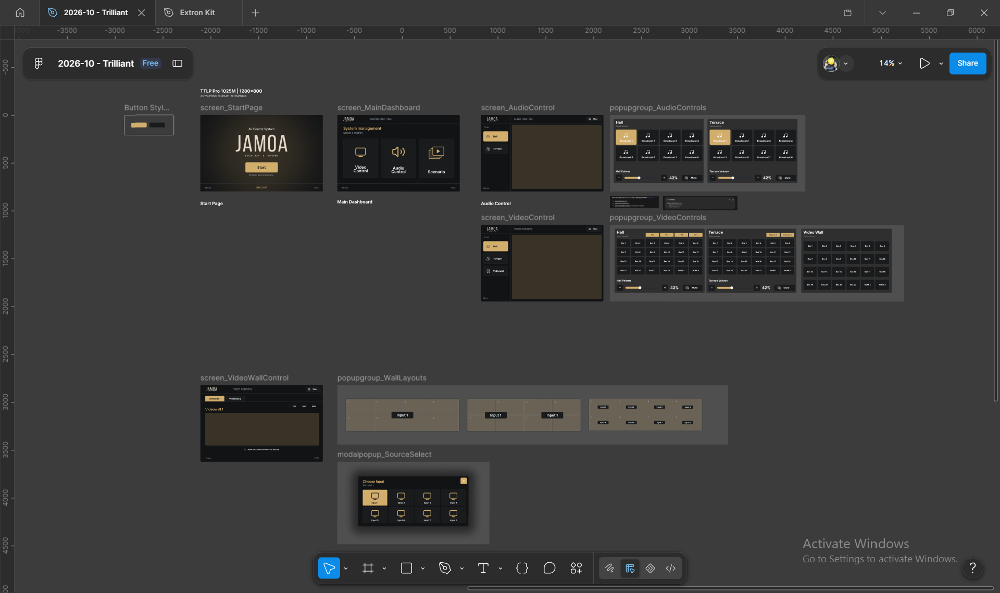
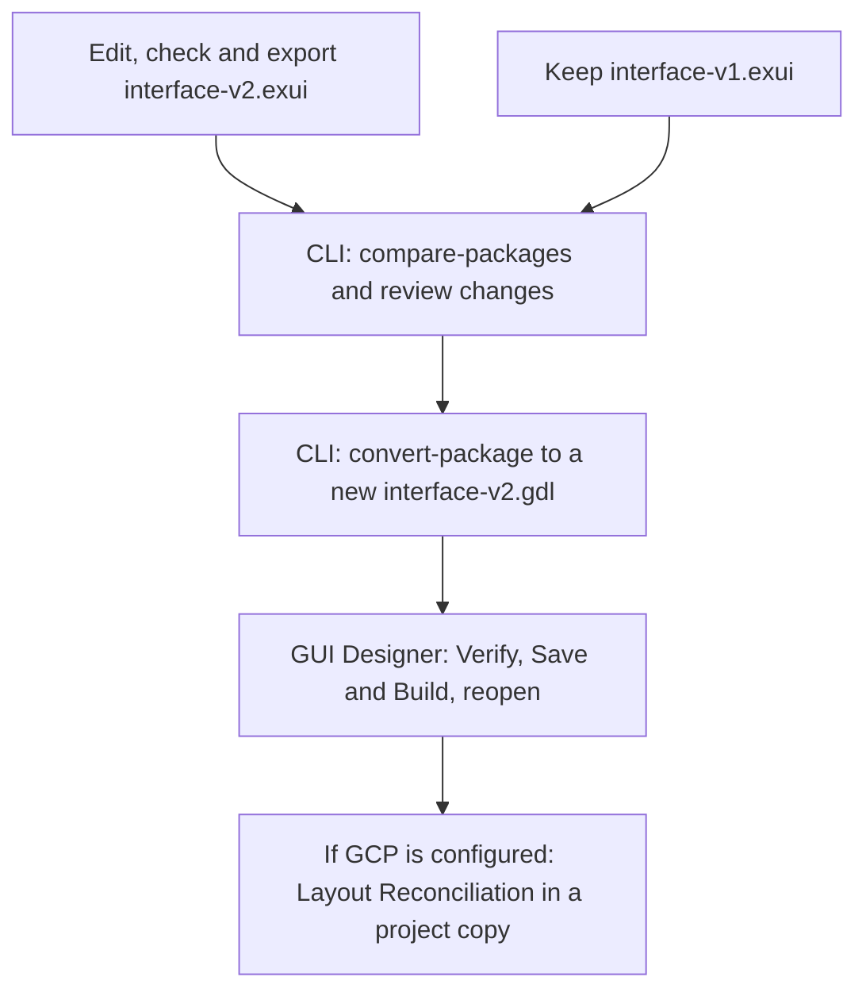

<h1 align="center">Figma → Extron Exporter</h1>

<p align="center"><strong>English</strong> · <a href="README.ru.md">Русский</a></p>

<p align="center">
  <strong>From a touch panel mockup to an editable Extron project.</strong><br>
  Buttons, sliders and supported labels stay editable in GUI Designer.
</p>

<p align="center">
  <a href="#project-status"></a>
  <a href="#compatibility"></a>
  <a href="#compatibility"></a>
</p>

<p align="center">
  <a href="https://github.com/Elguajo/figma-extron-exporter/releases"><strong>Download preview</strong></a> ·
  <a href="#quick-start">Quick start</a> ·
  <a href="#documentation">Documentation</a> ·
  <a href="docs/development.md#english">Development</a>
</p>



<p align="center"><sub>A real use case: JAMOA AV control · TLP Pro 1025M · plugin 0.8.4.<br>Figma screens and popup groups on the left; project export settings on the right.</sub></p>

---

## How it works

Prepare a screen in Figma, export an `.exui` package and convert it to `.gdl` with the local CLI. The result opens in **Extron GUI Designer**: controls, states and supported text remain editable.



| In Figma | In the Extron project |
|---|---|
| Screen and popups | Pages, popups and the links between them |
| Buttons and their states | Native controls with separate artwork per state |
| Sliders, values and labels | Editable elements; text within the [font contract](src/figma-plugin/NATIVE_TEXT.md#english) |
| Icons and complex artwork | PNG resources |
| Saved assignments | Element IDs and a map for the programmer; IDs are kept when existing layers are edited |

The mockup follows naming and structure rules. For example, `button_Mute` becomes a button, and the Extron programmer connects the mute command and its feedback from the hardware. Figma Prototype interactions are not transferred automatically.

<details>
<summary><strong>Explore the real Figma project without the plugin window</strong></summary>



The same project as in the opening screenshot. Screens, popup groups and a source selection modal are prepared separately on the canvas; the plugin is set to export the current page as one project. This screenshot shows layout preparation, not a verified GDL export.

</details>

<details>
<summary><strong>See a real export opened in GUI Designer</strong></summary>


Checked on **21 Oct 2026**, TLP Pro 1025M: 47 elements, 15 PNGs, **Verify: 0 errors / 0 warnings**, Save and Build and reopening. This is a separate working mockup; see the [report and limits of the check](docs/verification/results/2026-10-21-home-layout-1025m.md) (in Russian).

</details>

## Compatibility

| What you need | What for |
|---|---|
| **Figma Desktop** and edit access to the Design file | Prepare and export your mockup |
| **TLP Pro 1025M** — 1280 × 800 or **TLP Pro 300M** — portrait 320 × 480 | Choose the screen size and the export profile |
| **Windows**, [.NET 10 Runtime x64](https://dotnet.microsoft.com/download/dotnet/10.0), **GUI Designer 1.28.0.7** | Convert the export to GDL and open the result |

The plugin creates an `.exui` file — a package that describes the elements and their artwork. A separate **CLI** converter turns this package into a `.gdl` project for GUI Designer. The converter is set up once by following the [CLI setup guide](docs/cli-setup.md#english).

## Quick start

**Your screen in Figma → check → download EXUI → convert → open the GDL.**

### 1. Install and run the plugin

1. Open [GitHub Releases](https://github.com/Elguajo/figma-extron-exporter/releases). Under **Assets** of the chosen release, download two archives: `figma-extron-plugin-<version>.zip` and the compatible `figma-extron-cli-<version>-windows.zip` named in that release.
2. Unpack each archive into its own permanent folder. You do not need to open the ZIP files in Figma.
3. Open your mockup in **Figma Desktop**. You need a Design file that you can edit.
4. In the Figma menu choose **Plugins → Development → Import plugin from manifest…** and select `manifest.json` from the unpacked plugin folder.
5. In the same menu choose **Plugins → Development → "Figma → Extron Exporter"** — the whole last name refers to our plugin. Its window opens with the panel profile selector and the **Проверить макет** (Check layout) / **Скачать .exui** (Download .exui) buttons.

The plugin interface is in Russian. This guide shows each label exactly as it appears, followed by its English meaning.

As of 24 Oct 2026, kit **0.7.2** is published. The version in the window title must match the version of the plugin you downloaded. When updating, keep the `id` in `manifest.json`: element assignments in your Figma file are tied to it.

### 2. Prepare one screen of your design

Start with one screen. In the **Layers** panel select its outer **Frame**, set the size of your panel and name it `screen_Home`. Export does not resize anything: 1025M needs **1280 × 800**, 300M needs **320 × 480**.

Name the elements inside the screen so that the plugin understands their purpose:

| Element of your design | Layer name in Figma | Result |
|---|---|---|
| Mute button | `button_Mute` | Extron button with two states |
| Plain label | `text_Title` | Static label |
| Changing volume value | `value_Volume` | Label with its own ID that the program updates |
| Picture or logo in its own Frame | `image_Background` / `logo_Company` | PNG image |

Place these elements **directly inside the screen Frame**. After the prefix (`button_`, `text_` and so on), start the name with a Latin letter; then Latin letters, digits, dots and hyphens between non-empty parts are allowed. Spaces and extra `_` are not allowed; the visible text may be in any language.

For editable labels use **Inter / Inter Display** or **Arial Regular / Bold**. Other fonts and complex styling of static text may become a picture; values that change follow the [native text rules](src/figma-plugin/NATIVE_TEXT.md#english).

**A button needs two looks.** Inside the Group or Frame `button_Mute`, place two Groups or Frames of the same size covering the whole button: `Off` — the normal look, `On` — the active look. Keep the background, icon and text of each state inside it; stack the states on top of each other and hide one. Remove the fill from the outer `button_Mute` Frame: the artwork lives inside the states. For hold buttons such as "+" and "−", use the names `Normal` / `Pressed`.

You can take a ready-made button or slider from **Библиотека компонентов → Создать Extron Kit** (Component library → Create Extron Kit) in the plugin window. Drag an instance from **Assets** into your screen and change the artwork while keeping the structure. Prepare your own sliders and more complex buttons by the [component rules](src/figma-plugin/AUTHORING_STANDARD.md) (in Russian) and the [button states guide](src/figma-plugin/BUTTON_STATES.md#english).

<details>
<summary>Example layer structure of a finished button</summary>

```text
screen_Home
├── button_Mute
│   ├── Off                     normal look: background + icon + text
│   └── On                      active look: background + icon + text
├── text_Title
└── value_Volume
```

Full list of names: [prefix reference](src/figma-plugin/PREFIXES.md#english). Several screens, popups and navigation: [layout standard](src/figma-plugin/AUTHORING_STANDARD.md) (in Russian).

</details>

### 3. Check the screen and download the EXUI

1. In **Layers**, select the outer `screen_Home` Frame itself so that the whole screen is exported.
2. In the plugin window set **Что экспортировать → Выбранный экран или секция** (What to export → Selected screen or section).
3. In **Профиль панели** (Panel profile), choose your model: TLP Pro 1025M or TLP Pro 300M.
4. At the bottom of the window click **Проверить макет** (Check layout). On success, a message reports the checked layout and the number of elements. IDs are assigned automatically; you do not need to fill them in for the first export.
5. If an error is shown, click **Показать слой** (Show layer) in the report, fix the reported cause and check again.
6. Click **Скачать .exui** (Download .exui). Find the downloaded file, usually in your **Downloads** folder. Its name depends on the profile, for example `interface-tlp-pro-1025m.exui`.

In the [plugin screenshot above](docs/assets/readme/figma-project-export.png), scope and panel profile are at the top; **Проверить макет** (Check layout) and **Скачать .exui** (Download .exui) stay at the bottom. That example exports the whole current page; for this first run choose the selected screen scope described in step 2.

**You now have an EXUI of your design.** It is an intermediate package; the next step creates a file that opens in GUI Designer.

### 4. Convert your EXUI to GDL

For the first run, complete the [one-time converter setup](docs/cli-setup.md#english), including the required Extron files. After that, export a new EXUI and repeat the commands below.

1. Open the unpacked CLI folder — it contains `ExtronExporter.ps1`.
2. Copy the downloaded `.exui` into this folder. For the commands below, name the copy **`interface.exui`**.
3. Type `powershell` in the **File Explorer** address bar and press Enter. PowerShell opens in the CLI folder.
4. First validate the package, then create a new GDL:

```powershell
.\ExtronExporter.ps1 validate-package .\interface.exui
.\ExtronExporter.ps1 convert-package .\interface.exui .\interface-v1.gdl
```

The first command prints information about your layout; the number of elements depends on the design. After the second command, **`interface-v1.gdl`** and **`interface-v1.gdl.report.json`** appear in the same folder — the project and the report of its independent check.

### 5. Open and check the result

In **GUI Designer**, choose **File → Open** and open `interface-v1.gdl`. Check the panel profile, element positions, labels and button states. Run **Verify → Save and Build**, then close and reopen the project.

To hand over to the programmer, create an ID map from the same EXUI:

```powershell
.\ExtronExporter.ps1 id-map .\interface.exui | Out-File -Encoding utf8 id-map.md
```

Hand over the **GDL and `id-map.md`** — the map of pages, popups, IDs and states. The programmer connects hardware commands and feedback in the Extron control program.

## Extron Kit

The plugin includes **Extron Kit**, an editable Figma library. Choose your panel profile, then **«Библиотека компонентов» → «Создать Extron Kit»** (Component library → Create Extron Kit).

| Included | What you can use |
|---|---|
| Components and states | Buttons, source selection, Mute, volume controls, text, indicators, shapes and images. |
| Project templates | Pages, popups, modal dialogs and popup groups. |
| Ready-made screen examples | Home, system start, presentation, audio zones, connection help, system status and shutdown confirmation. |
| Supporting assets | 18 AV icons and 28 date/time formats. |

The kit has separate layouts for **TLP Pro 1025M (1280×800)** and **TLP Pro 300M (320×480, portrait)**. Change the artwork and captions while keeping the service names and structure. A new kit is created next to existing objects; existing libraries are not updated automatically. Hardware commands and feedback are connected by the Extron programmer.

[Working with Extron Kit](src/figma-plugin/EXTRON_KIT.md#english) · [Offline catalog and examples](docs/web/index.html) (in Russian)

## Exporting again



After the first successful export, save a copy of `interface.exui` as **`interface-v1.exui`**. Edit your screen in Figma, select its outer Frame again and click **Проверить макет → Скачать .exui** (Check layout → Download .exui). Copy the new export into the CLI folder as **`interface-v2.exui`**.

Compare the versions and create a new GDL:

```powershell
.\ExtronExporter.ps1 compare-packages .\interface-v1.exui .\interface-v2.exui
.\ExtronExporter.ps1 convert-package .\interface-v2.exui .\interface-v2.gdl
```

The comparison shows new and removed elements and changes of IDs, types, states and links. Existing editable layers keep their IDs; new and copied elements get their own IDs.

**Every conversion creates a new GDL.** An existing file is never overwritten, and manual edits of the previous GDL are not carried into the new one. Open the new `interface-v2.gdl` and check it again in GUI Designer.

If the control logic is already configured in **Global Configurator (GCP)**, update a copy of the working project with **Layout Reconciliation** — matching the changed interface against the existing configuration. For the 1025M test pair, keeping actions/feedback and reopening are confirmed; see the [guide and limits of the check](docs/updating-configured-projects.md#english).

## Troubleshooting

| Message | What to do |
|---|---|
| `donor-missing` / `donor-hash` | Complete the [one-time converter setup](docs/cli-setup.md#required-extron-files) |
| `extron-version` | GUI Designer 1.28.0.7 is required; set another install path with `--extron-dir <folder>` |
| `output-exists` | Choose a new name for the output GDL |
| The EXUI downloaded, but GUI Designer does not open it | First [convert the package to GDL](#4-convert-your-exui-to-gdl); open the resulting `.gdl` in GUI Designer |
| The CLI cannot find `interface.exui` | Copy your downloaded EXUI into the folder with `ExtronExporter.ps1`, name the copy `interface.exui` and open PowerShell in exactly that folder |
| An EXUI/1–4 package is refused | Export the layout again with the current plugin; saved assignments and IDs are reused |
| A layer name or structure error | Fix the reported layer from the plugin report and check again |

CLI exit codes: **0** — success, **1** — processing error, **2** — invalid arguments. [All commands and options](docs/development.md#cli-commands).

## Documentation

Each guide is one file with the Russian text first and the English text below; the links here open the English part. Design notes, research, reports and release notes are in Russian.

| Task | Guide |
|---|---|
| Set up the converter or check the bundled example | [CLI setup](docs/cli-setup.md#english) |
| Follow a practical workflow | [Five use cases PDF](docs/prefix_map/figma-extron-use-cases.pdf) · [Offline documentation](docs/web/index.html) (Russian) |
| Prepare a layout | [Authoring standard](src/figma-plugin/AUTHORING_STANDARD.md) (in Russian) |
| Name elements | [Prefix reference](src/figma-plugin/PREFIXES.md#english) · [Prefix rules in detail](docs/figma-prefix-reference.md#english) · [PDF cheat sheet](docs/prefix_map/figma-extron-prefix-cheatsheet.pdf) |
| Design buttons and states | [Button states](src/figma-plugin/BUTTON_STATES.md#english) |
| Keep text editable | [Fonts and native text](src/figma-plugin/NATIVE_TEXT.md#english) |
| Use the library | [Extron Kit](src/figma-plugin/EXTRON_KIT.md#english) |
| Plugin reference | [Plugin guide](src/figma-plugin/README.md#english) |
| Update a configured GCP project | [Updating projects](docs/updating-configured-projects.md#english) |
| Support new Extron versions | [Extron compatibility](docs/extron-compatibility.md#english) |
| Understand the format and architecture | [EXUI/5](docs/exui-v5.md#english) · [GDL format](docs/extron-format.md) (in Russian) · [Decisions](docs/decisions.md) (in Russian) |
| Check the result | [Checklist](docs/verification/checklist.md#english) · [0.8.4 checks](docs/verification/results/2026-10-25-release-0.8.4.md) (in Russian) |
| See changes and plans | [CHANGELOG](CHANGELOG.md) · [ROADMAP](ROADMAP.md) (in Russian) |

## Build and checks

This section is for working with the sources. Installing from the ready archives does not need Node.js or the .NET SDK. Current sources: **plugin 0.8.4 + CLI 0.8.3**, EXUI/5.

Development needs **.NET SDK 10.0.402** and **Node.js ≥ 22.18**. From the repository root:

```powershell
dotnet build ExtronExporter.slnx
npm ci --prefix src/figma-plugin --ignore-scripts
npm run verify --prefix src/figma-plugin
```

`verify` type-checks, runs the plugin tests and builds `src/figma-plugin/dist/`. Import `src/figma-plugin/manifest.json` into Figma Desktop.

[Architecture, .NET tests, CLI commands and releases](docs/development.md#english)

## Project status

**Preview.** The full Figma → EXUI → GDL → GUI Designer Verify → Save and Build → reopen cycle is confirmed for [Home 1025M](docs/verification/results/2026-10-21-home-layout-1025m.md). Both panels have automated scenarios; [release 0.7.3](docs/verification/results/2026-10-23-release-0.7.3.md) was checked from the final archives with a real conversion and an independent GDL reader. A new manual Desktop run was not done for this release.

Work on a physical panel, touches, holds and hardware feedback are not verified yet. Every new project needs its own check in GUI Designer and on the hardware.

The plugin's styling and parts of its export are adapted from **Baolv/figma-export** with permission; code origin and dependency licenses are in [THIRD_PARTY_NOTICES.md](src/figma-plugin/THIRD_PARTY_NOTICES.md).

## License

© 2026 Khusan Turaev, all rights reserved. The code is open for reading, and unmodified releases may be used freely. Changing, copying or distributing the code requires the author's written permission — ask for it through an issue in this repository. See [LICENSE](LICENSE) for details.
